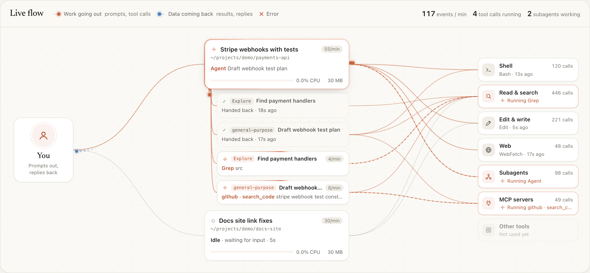

# Claude Code agent monitor

A local dashboard for every Claude Code session on your machine. It shows each session's status, current task, tools, subagents, live transcript and CPU and memory use, plus a searchable history of past sessions. It has no dependencies.



```sh
npx claude-code-agent-monitor --open
```

Or install it once:

```sh
npm install -g claude-code-agent-monitor
claude-code-agent-monitor --open
```

It needs macOS or Linux, Node 18 or later, and Claude Code, whose session files it reads from `~/.claude`.

This is an unofficial community tool, not made by or affiliated with Anthropic.

## Options

| Option | |
|---|---|
| `--port <n>` | Port to listen on. Default `4317` |
| `--open` | Open the dashboard in your browser |
| `--version` | Print the version |
| `--help` | Show help |

To run it from a clone of this repo instead: `npm start`.

## What it shows

- **Live flow.** A diagram of you, your agents and the tools they use, with every transcript event drawn as a particle:
  - coral particles carry work going out: your prompts and tool calls
  - blue particles carry data coming back: tool results and Claude's replies
  - a failed tool call sends a red particle and the tool flashes ✕
  - a working agent has a rotating coral border, and a link to a tool that is still running shows moving dashes
  - each agent shows its current tool, events per minute, CPU and memory; click one to inspect it
  - subagents hang under their parent with their own links to the tools they use. Their task travels down to them, and their answer travels back up to the parent. A finished subagent shows "✓ Handed back" for 2 minutes. Click one to open its transcript.
- **Inspector.** For the selected agent:
  - session metadata: model, context size, client, start time
  - current activity, including the full command for Bash calls
  - last prompt
  - CPU and memory charts for the last 3 minutes, also viewable as a table
  - the process tree, including the tools and MCP servers it spawned
  - its subagents
- **Log.** Prompts, replies, tool calls and tool results stream in as they happen. You can filter by kind, follow the newest entry, and switch to a subagent's transcript.
- **Totals.** Running agents, combined CPU and memory, and output tokens.
- **History.** Open it with the History switch in the header. It lists every session Claude Code still has on disk, grouped by day, with search and a folder filter. Each row shows the title, folder, git branch, prompts, tool calls, output tokens, subagents and time span; running sessions are marked. Pick one to see:
  - its first and last prompt, and a chart of the tools it used most
  - its full transcript in the same viewer as the inspector, newest first, with **Load earlier** for long sessions
  - its subagents' transcripts
  - the **Copy resume command** button

  Links like `#history/<session-id>` open a session directly. Claude Code deletes transcripts after `cleanupPeriodDays` (30 by default, set in `~/.claude/settings.json`), so that is as far back as history goes.

## Where the data comes from

Everything is read-only and local:

| Source | Used for |
|---|---|
| `~/.claude/sessions/<pid>.json` | Which sessions are live, their busy/idle status, cwd and name |
| `~/.claude/projects/<slug>/<sessionId>.jsonl` | Title, last prompt, current tool, model, tokens, log |
| `~/.claude/projects/<slug>/<sessionId>/subagents/agent-*.jsonl` | Subagent transcripts. Their `.meta.json` gives the agent type and description |
| `ps`, plus `lsof` on macOS or `/proc` on Linux | CPU and memory for each agent's whole process tree |

The server samples every 2 seconds and pushes snapshots to the page over Server-Sent Events. Transcripts are read incrementally, so it only parses bytes appended since the last tick.

History reads every stored transcript the first time you open it, which takes a few seconds for about 100 MB. After that it only reads what was appended, so refreshes are near-instant. It skips Claude Code's request-log lines, which are large and not shown anywhere.

The CPU figure counts 100% as one full core. It is measured from the change in CPU time between samples, so it reflects the last 2 seconds rather than a long-run average.

A `claude` process with no session file still appears, marked **Running**. This covers older versions and some headless runs. Only its process stats are available.

## Configuration

| Env var | Default | |
|---|---|---|
| `PORT` | `4317` | |
| `HOST` | `127.0.0.1` | Interface to bind to |
| `CLAUDE_CONFIG_DIR` | `~/.claude` | Same variable Claude Code uses |
| `AGENTMON_UNTRACKED` | `1` | `0` skips the scan for `claude` processes with no session file |

## Security

Transcripts contain everything you and Claude have typed, including file contents and command output. So the server:

- binds to localhost only
- rejects requests whose `Host` header isn't `localhost` or `127.0.0.1`, which blocks DNS-rebinding attacks from web pages

Setting `HOST=0.0.0.0` will **not** expose it on your network, because the Host check still applies. That is deliberate. To view the dashboard from another device, use an SSH tunnel.
